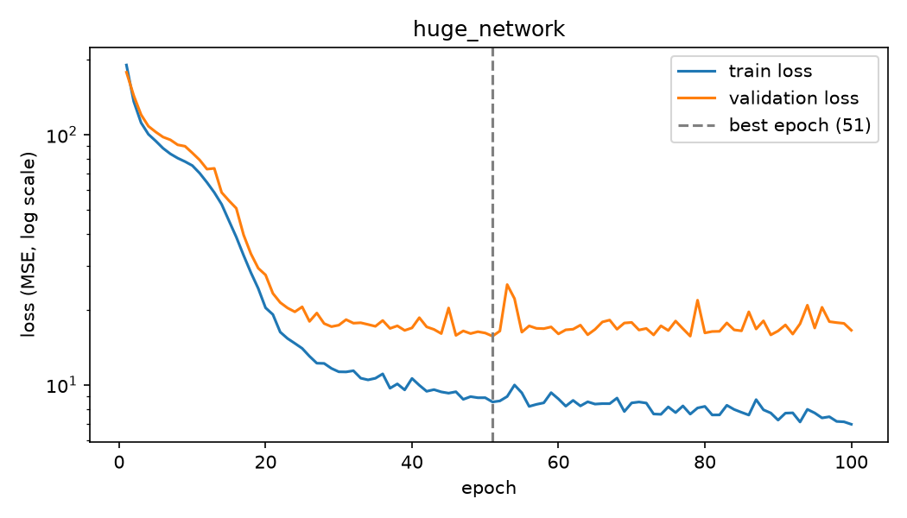

# Lakeshore Bike Demand

## What it does

This project predicts how many bikes will be rented at a Lakeshore Bike Share station in a given hour, using the hour of the day, the weather, whether it is a weekend and the type of station. It trains a small neural network in PyTorch with a training loop written by hand, and compares it honestly with two simple models: the training mean and a linear regression. Everything (numbers, tables and images) is recreated by running `python train.py`.

## How to run it

```
git clone https://github.com/pardevashree/lab07-first-principles.git
cd lab07-first-principles
conda env create -f environment.yml
conda activate lab07-first-principles
python train.py
python -m pytest
python -m ruff format --check .
python -m ruff check .
```

`python train.py` takes a minute or two. It rewrites everything in `reports/`:

| File | Content |
|---|---|
| `learning_curves.png` | Learning curves of the final network |
| `curves_<run>.png` | Learning curves of every run |
| `history.csv` | One row per epoch for the final network |
| `experiments.csv` | One row per run |
| `metrics.json` | Baselines and the single test result |

## Data and split

The data comes from `bikes_data.py` (given, never edited). `make_rentals()` builds 6,000 invented station-hours from a fixed seed, so everyone gets identical rows. Each row has the hour, temperature, rain, wind, a weekend flag, the station type and the number of bikes rented (the target).

- **Split:** 60% train (3,600 rows), 20% validation (1,200 rows) and 20% test (1,200 rows), with `random_state=42`. The split is made before any preparation.
- **Fitted on train only:** the `StandardScaler` for hour, temperature, rain and wind, and the `OneHotEncoder` for station type. Validation and test rows are only transformed with the numbers learned from the train rows, so no information leaks from them. The weekend flag is already 0 or 1 and is passed through.
- **Result:** 8 input features (4 scaled, 1 weekend flag, 3 station-type columns).

**Linear model and the shape of the data.** When I plotted the average rentals against the hour, the curve had two peaks (a morning and an afternoon rush hour), shaped like an M. A straight line cannot follow that shape, so I expected the linear model to do only slightly better than the mean. The results below confirm this.

## Model and training

- **Network (`model.py`):** an `nn.Module` with two hidden layers, each followed by ReLU, and a last linear layer with one output and no activation, because the target is a count and not a probability. The input has 8 features.
- **Loss:** mean squared error (`nn.MSELoss`). The validation MAE, in rentals, is also logged.
- **Optimizer:** Adam, with the learning rate set per run (see Experiments).
- **Batches:** 64 rows. Only the training loader shuffles.
- **Epochs:** 100 for every run. After each epoch the training loss, validation loss and validation MAE are logged. At the end, the weights of the epoch with the lowest validation loss are put back.
- **Loop (`train.py`):** `run_epoch` trains when it is given an optimizer and only measures otherwise. It uses `optimizer.zero_grad()`, `loss.backward()` and `optimizer.step()`. `fit` calls it for many epochs and keeps the best weights.
- **Seeds:** the split uses `random_state=42`. `torch.manual_seed(42)` is called before every run, and the training DataLoader uses a `torch.Generator` seeded with 42. Running `python train.py` twice on the same computer gives identical numbers. They may differ in the last digits on another computer.

**How the final network was chosen.** The final network is the run with the lowest validation MAE, chosen using the validation rows only. The test rows are evaluated once, for that network. Note: in my first run of `train.py`, the test score of the `main` run was printed (MAE 4.29), because `main` was still treated as the final network. The validation results then showed that the `huge_network` run was much better (validation MAE 2.63 against 4.38), so I changed `train.py` to choose the final network by validation MAE. The choice rests on validation, and the gap was large. Still, the test rows were seen once before the choice, so the test number is a little less clean than a test set that was never looked at.

## Results

Mean absolute error in rentals (bikes per station-hour). Lower is better.

| Model | Validation MAE | Test MAE |
|---|---|---|
| Training mean | 10.15 | 9.65 |
| Linear regression | 9.32 | 8.57 |
| Network (`huge_network`, hidden size 512) | 2.63 | 2.49 |

The final test result for the network is **MAE 2.49 rentals** (test MSE loss 13.18). The network is off by about 2.5 bikes on average, against about 9 to 10 for the two simple models.

**Why the linear model does not do well:** the average rentals by hour form an M-shaped curve with two rush-hour peaks, and a straight line cannot follow it, so the linear model is only a little better than predicting the mean.


**What the curves show:** both losses fall quickly for the first 20 to 25 epochs. After that the validation loss stays almost flat (around 16 to 20, with small spikes), while the training loss keeps falling slowly. The widening gap between the two lines is mild overfitting. The best epoch (the dashed line, epoch 51) is the lowest point of that flat, noisy part of the validation curve, and the weights of epoch 51 are the ones kept. Because the validation curve is so flat, other epochs between about 25 and 100 would give a similar result.

## Experiments

Every run changes one thing from the `main` run (hidden size 32, learning rate 0.001, batch size 64, 100 epochs). The final losses are from the last epoch (epoch 100), not from the best epoch.

| Run | Hidden size | Learning rate | Best epoch | Best validation MAE | Final train loss | Final validation loss |
|---|---|---|---|---|---|---|
| `main` | 32 | 0.001 | 100 | 4.378 | 36.304 | 43.956 |
| `lr_too_small` | 32 | 0.00001 | 100 | 10.144 | 273.764 | 315.494 |
| `lr_too_large` | 32 | 0.5 | 26 | 7.849 | 194.205 | 221.845 |
| `huge_network` | 512 | 0.001 | 51 | 2.634 | 6.954 | 16.525 |




**`main` (fine, but still improving).** The best epoch is the last one (100), so the loss was still falling when training stopped. The training and validation losses are close (36.3 and 44.0), so there is no overfitting. A wider network or more epochs would help. It beats both baselines (validation MAE 4.38).

**`lr_too_small` (underfitting).** With a learning rate of 0.00001 the steps are tiny. Both curves are smooth but fall very slowly, and they are still high at epoch 100 (the best epoch is the last one). The validation MAE (10.14) is almost the same as the mean baseline (10.15), so the network has hardly learned anything. The validation loss stays above the training loss for the whole run, which is normal because they are different rows. The problem is that both are high and still falling.

**`lr_too_large` (unstable).** With a learning rate of 0.5 the steps are huge. For the first 60 epochs both curves bounce up and down instead of settling. The lowest validation loss is a lucky dip at epoch 26 (the best epoch), not a stable point. Around epoch 60 the losses jump up and stay on a flat, high level (train loss about 190, validation loss about 220) for the rest of the run. This means the network is stuck and has stopped learning, probably because the big steps pushed the weights to a bad place. The best validation MAE (7.85) is much worse than `main`.

**`huge_network` (best, with some overfitting).** With 512 hidden units, the network is much larger than 3,600 rows need. The training loss ends far below the validation loss (6.95 against 16.5). The validation loss stops improving after about epoch 25, while the training loss keeps falling, so the network starts fitting the noise in the training rows. Even so, restoring the weights of the best epoch (51) gives the lowest validation MAE of all runs (2.63), so this is the final network.

## Limitations

- **Who the data represent:** the table is invented by a generator. It is not real Lakeshore Bike Share data, so the numbers show how the method works, not how real riders behave.
- **What the model cannot see:** holidays, events, school terms, the exact location of a station, how many bikes were available (an empty station cannot be rented from), and any trend over weeks or seasons. It only knows the hour, the weather, the weekend flag and the station type.
- **Evidence behind the results:** every result comes from one split and one seed. A different seed could change the numbers a little, and no confidence intervals are given.
- **What a planner should not use it for:** do not use it for real decisions about moving bikes before it has been trained and tested on real station data. The error of about 2.5 bikes is an average, so it can be much larger in busy hours at busy stations. It predicts the rentals of one station-hour and says nothing about a whole city or a future with different conditions.