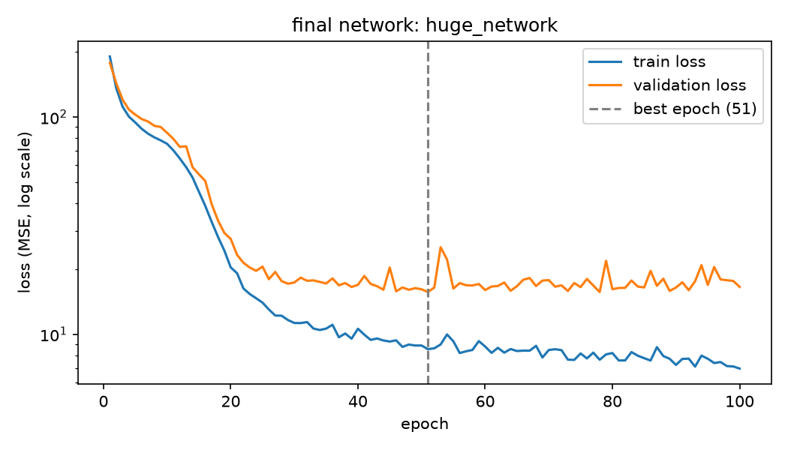
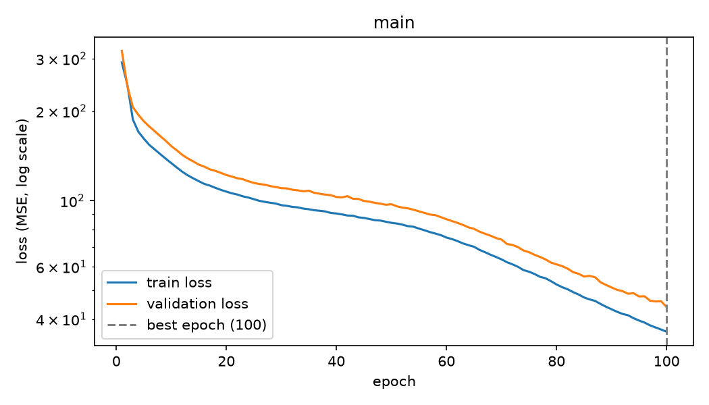
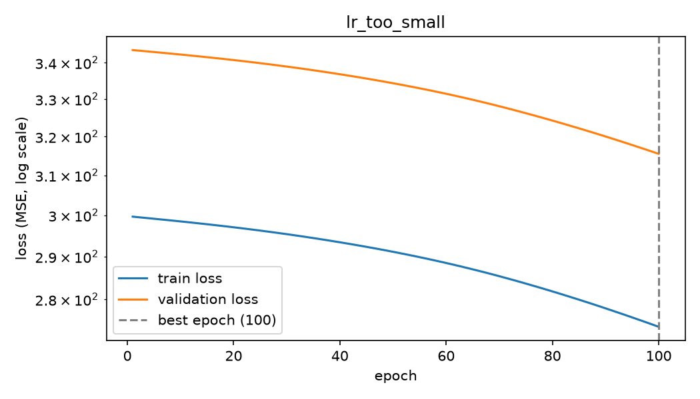
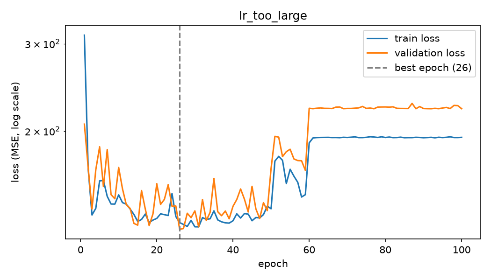
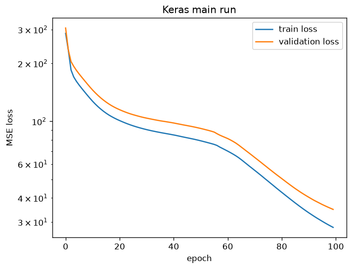

# Lakeshore Bike Demand: the same model in PyTorch and Keras

## What it does

This project predicts how many bikes will be rented at a Lakeshore Bike Share station in a given hour, using the hour of the day, the weather, whether it is a weekend and the type of station. The model is a small neural network. It was first written in PyTorch with a training loop written by hand (Lab 07), and in this lab (Lab 08) it is built a second time in Keras. The two versions are checked to be the same function, trained fairly on three seeds, and compared. `COMPARISON.md` holds the observations and a framework recommendation.

Everything (numbers, tables and images) is recreated by running `python train.py`, `python train_keras.py` and `python compare.py`.

## How to run it

```
git clone https://github.com/pardevashree/lab08-same-model-twice.git
cd lab08-same-model-twice
conda env create -f environment.yml
conda activate lab08-same-model-twice
python train.py
python train_keras.py
python compare.py
python -m pytest
python -m ruff format --check .
python -m ruff check .
```

- `python train.py` (PyTorch, from Lab 07) takes a minute or two.
- `python train_keras.py` trains the Keras main run (about 20 seconds).
- `python compare.py` trains six models (three seeds, two frameworks) and takes a few minutes.

They rewrite everything in `reports/`:

| File | Content |
|---|---|
| `learning_curves.png` | Learning curves of the final PyTorch network |
| `curves_<run>.png` | Learning curves of every PyTorch run |
| `history.csv` | One row per epoch for the final PyTorch network |
| `experiments.csv` | One row per PyTorch run |
| `metrics.json` | Baselines and the single test result of the final PyTorch network |
| `learning_curves_keras.png` | Learning curves of the Keras main run |
| `history_keras.csv` | One row per epoch for the Keras main run |
| `comparison.csv` | Framework, seed, best epoch, validation MAE, test MAE and seconds for each of the six runs |
| `best_keras.keras` | Checkpoint saved by `ModelCheckpoint` (**not committed**, see below) |

**The checkpoint file.** `reports/best_keras.keras` is a binary file of about 41 KB. It is listed in `.gitignore` and is not committed. Running `python train_keras.py` recreates it.

## Data and split

The data comes from `bikes_data.py` (given, never edited). `make_rentals()` builds 6,000 invented station-hours from a fixed seed, so everyone gets identical rows. Each row has the hour, temperature, rain, wind, a weekend flag, the station type and the number of bikes rented (the target).

- **Split:** 60% train (3,600 rows), 20% validation (1,200 rows) and 20% test (1,200 rows), with `random_state=42`. The split is made before any preparation.
- **Fitted on train only:** the `StandardScaler` for hour, temperature, rain and wind, and the `OneHotEncoder` for station type. Validation and test rows are only transformed with the numbers learned from the train rows, so no information leaks from them. The weekend flag is already 0 or 1 and is passed through.
- **Result:** 8 input features (4 scaled, 1 weekend flag, 3 station-type columns).
- **Same rows in both frameworks:** `prepare.py` is not changed in this lab. The Keras version uses the same prepared arrays that the PyTorch version uses. The data is not prepared a second time.

**Linear model and the shape of the data.** When I plotted the average rentals against the hour, the curve had two peaks (a morning and an afternoon rush hour), shaped like an M. A straight line cannot follow that shape, so I expected the linear model to do only slightly better than the mean. The results below confirm this.

## Model and training

- **Network (`model.py`):** an `nn.Module` with two hidden layers, each followed by ReLU, and a last linear layer with one output and no activation, because the target is a count and not a probability. The input has 8 features.
- **Loss:** mean squared error (`nn.MSELoss`). The validation MAE, in rentals, is also logged.
- **Optimizer:** Adam, with the learning rate set per run (see Experiments).
- **Batches:** 64 rows. Only the training loader shuffles.
- **Epochs:** 100 for every run. After each epoch the training loss, validation loss and validation MAE are logged. At the end, the weights of the epoch with the lowest validation loss are put back.
- **Loop (`train.py`):** `run_epoch` trains when it is given an optimizer and only measures otherwise. It uses `optimizer.zero_grad()`, `loss.backward()` and `optimizer.step()`. `fit` calls it for many epochs and keeps the best weights.
- **Seeds:** the split uses `random_state=42`. `run_experiment` takes a `seed` (default 42) and calls `torch.manual_seed(seed)` before every run. The training DataLoader uses a `torch.Generator` seeded with the same value. Running `python train.py` twice on the same computer gives identical numbers. They may differ in the last digits on another computer.

**How the final network was chosen.** The final network is the run with the lowest validation MAE, chosen using the validation rows only. The test rows are evaluated once, for that network. Note: in my first run of `train.py`, the test score of the `main` run was printed (MAE 4.29), because `main` was still treated as the final network. The validation results then showed that the `huge_network` run was much better (validation MAE 2.63 against 4.38), so I changed `train.py` to choose the final network by validation MAE. The choice rests on validation, and the gap was large. Still, the test rows were seen once before the choice, so the test number is a little less clean than a test set that was never looked at.

## Results

Mean absolute error in rentals (bikes per station-hour). Lower is better.

| Model | Validation MAE | Test MAE |
|---|---|---|
| Training mean | 10.15 | 9.65 |
| Linear regression | 9.32 | 8.57 |
| Network (`huge_network`, hidden size 512) | 2.63 | 2.49 |

The final test result for the PyTorch network is **MAE 2.49 rentals** (test MSE loss 13.18). The network is off by about 2.5 bikes on average, against about 9 to 10 for the two simple models.

**Why the linear model does not do well:** the average rentals by hour form an M-shaped curve with two rush-hour peaks, and a straight line cannot follow it, so the linear model is only a little better than predicting the mean.



**What the curves show:** both losses fall quickly for the first 20 to 25 epochs. After that the validation loss stays almost flat (around 16 to 20, with small spikes), while the training loss keeps falling slowly. The widening gap between the two lines is mild overfitting. The best epoch (the dashed line, epoch 51) is the lowest point of that flat, noisy part of the validation curve, and the weights of epoch 51 are the ones kept. Because the validation curve is so flat, other epochs between about 25 and 100 would give a similar result.

## Experiments

Every run changes one thing from the `main` run (hidden size 32, learning rate 0.001, batch size 64, 100 epochs). The final losses are from the last epoch (epoch 100), not from the best epoch. These are the PyTorch runs from Lab 07.

| Run | Hidden size | Learning rate | Best epoch | Best validation MAE | Final train loss | Final validation loss |
|---|---|---|---|---|---|---|
| `main` | 32 | 0.001 | 100 | 4.378 | 36.304 | 43.956 |
| `lr_too_small` | 32 | 0.00001 | 100 | 10.144 | 273.764 | 315.494 |
| `lr_too_large` | 32 | 0.5 | 26 | 7.849 | 194.205 | 221.845 |
| `huge_network` | 512 | 0.001 | 51 | 2.634 | 6.954 | 16.525 |






**`main` (fine, but still improving).** The best epoch is the last one (100), so the loss was still falling when training stopped. The training and validation losses are close (36.3 and 44.0), so there is no overfitting. A wider network or more epochs would help. It beats both baselines (validation MAE 4.38).

**`lr_too_small` (underfitting).** With a learning rate of 0.00001 the steps are tiny. Both curves are smooth but fall very slowly, and they are still high at epoch 100 (the best epoch is the last one). The validation MAE (10.14) is almost the same as the mean baseline (10.15), so the network has hardly learned anything. The validation loss stays above the training loss for the whole run, which is normal because they are different rows. The problem is that both are high and still falling.

**`lr_too_large` (unstable).** With a learning rate of 0.5 the steps are huge. For the first 60 epochs both curves bounce up and down instead of settling. The lowest validation loss is a lucky dip at epoch 26 (the best epoch), not a stable point. Around epoch 60 the losses jump up and stay on a flat, high level (train loss about 190, validation loss about 220) for the rest of the run. This means the network is stuck and has stopped learning, probably because the big steps pushed the weights to a bad place. The best validation MAE (7.85) is much worse than `main`.

**`huge_network` (best, with some overfitting).** With 512 hidden units, the network is much larger than 3,600 rows need. The training loss ends far below the validation loss (6.95 against 16.5). The validation loss stops improving after about epoch 25, while the training loss keeps falling, so the network starts fitting the noise in the training rows. Even so, restoring the weights of the best epoch (51) gives the lowest validation MAE of all runs (2.63), so this is the final network.

## The Keras version

**What I built.**

- `keras_model.py` has `build_keras_net`, which builds the same network as `BikeNet` with `keras.Sequential`: two hidden `Dense` layers with ReLU and one `Dense(1)` output with no activation. The hidden size is configurable. For hidden size 32 both networks have 1,377 parameters (checked for several sizes in the tests).
- `train_keras.py` uses `compile` and `fit` with the same settings as the PyTorch main run: Adam, learning rate 0.001, batch size 64, MSE loss and 100 epochs. `EarlyStopping(restore_best_weights=True)` puts back the best weights. Its patience equals the number of epochs, so the run never stops early and both frameworks train for the same length. `ModelCheckpoint` saves the best model. The training loss, validation loss and validation MAE of every epoch are written to `reports/history_keras.csv`.
- `compare.py` trains the main configuration (hidden size 32, learning rate 0.001) in both frameworks on seeds 42, 43 and 44 and writes `reports/comparison.csv`. Each final model is scored on the test rows once.



The Keras main run on seed 42 has its best epoch at 100, like the PyTorch main run. The loss was still falling when training stopped.

**The equivalence check.** `copy_weights_to_keras` copies the weights of a PyTorch network into a Keras network. A PyTorch weight has the shape (outputs, inputs) and a Keras kernel has the shape (inputs, outputs), so each weight table is transposed (`.T`). The biases are copied as they are. After the copy, both networks predicted the same values on 200 random rows (hidden size 32). The largest difference was 3e-08, far below the tolerance of 1e-5. Before the copy the two networks differed by about 1.2, because they started from different random weights. Without the transpose Keras gives a shape error on the first and last layers. The middle layer (32 by 32) has a square shape, so it would pass silently, which is why the test uses different random weights.

**What cannot be identical.** Keras starts from Glorot uniform weights and PyTorch uses another scheme, so the two frameworks start from different initial weights. A seed makes each framework repeatable, not identical to the other. The order in which the rows are shuffled in each epoch is also different. The rows, loss, optimizer, learning rate, batch size and number of epochs are the same.

**Results over three seeds** (main configuration, hidden size 32, 100 epochs, on my Windows computer with CPU only):

| Framework | Seed | Best epoch | Validation MAE | Test MAE | Seconds |
|---|---|---|---|---|---|
| PyTorch | 42 | 100 | 4.378 | 4.286 | 15.5 |
| Keras | 42 | 100 | 3.979 | 3.919 | 18.5 |
| PyTorch | 43 | 100 | 5.644 | 5.621 | 11.1 |
| Keras | 43 | 100 | 4.694 | 4.620 | 17.8 |
| PyTorch | 44 | 100 | 5.757 | 5.582 | 11.0 |
| Keras | 44 | 100 | 3.385 | 3.289 | 17.9 |

| Framework | Mean validation MAE | Mean test MAE | Mean seconds |
|---|---|---|---|
| PyTorch | 5.260 | 5.163 | 12.5 |
| Keras | 4.019 | 3.943 | 18.1 |

Keras had the lower MAE on all three seeds and PyTorch was faster. I cannot say the framework is the cause. The likely reason is the different initial weights, every run was still improving at epoch 100, and three seeds are few. The PyTorch seed 42 run (validation MAE 4.378) matches the `main` run from Lab 07, so the PyTorch code is unchanged.

**Summary of the comparison.** I recommend PyTorch for this team: the weekly job already works and is tested in PyTorch, it is a small team, and the Hugging Face Transformers library is moving to PyTorch as its only backend. The full observations, what the team gives up, and what would change the recommendation are in [COMPARISON.md](COMPARISON.md).

## Tests

`python -m pytest` runs 24 test cases: 11 from Lab 07 and 13 new ones in `tests/test_keras.py` (9 test functions, one of them parametrized over five hidden sizes). The new tests check that:

- the Keras network returns one value per row;
- the parameter count equals the PyTorch network's for hidden sizes 1, 4, 16, 32 and 128 (the parametrized test);
- after the weight copy, both networks predict the same values within 1e-5;
- a kernel that is not transposed in the square middle layer would be caught (the gap becomes large);
- both versions use the same rows (the arrays given to Keras equal the tensors given to PyTorch);
- the Keras network can memorize one small batch;
- a saved and reloaded Keras model gives the same predictions;
- the best weights are restored, so the model scores the best epoch's validation loss;
- the same seed repeats a short run.

## Limitations

- **Who the data represent:** the table is invented by a generator. It is not real Lakeshore Bike Share data, so the numbers show how the method works, not how real riders behave.
- **What the model cannot see:** holidays, events, school terms, the exact location of a station, how many bikes were available (an empty station cannot be rented from), and any trend over weeks or seasons. It only knows the hour, the weather, the weekend flag and the station type.
- **Evidence behind the results:** every PyTorch experiment comes from one split and one seed. The comparison uses three seeds, which is too few to prove that one framework is more accurate. No confidence intervals are given.
- **Different starting weights:** the two frameworks start from different initial weights, so a difference in accuracy cannot be put down to the framework alone.
- **Short training:** the main runs were still improving at epoch 100 in both frameworks, so the scores are not the best this model could reach.
- **Timing:** the seconds were measured on one Windows computer without a GPU. Other hardware could give other numbers.
- **What a planner should not use it for:** do not use it for real decisions about moving bikes before it has been trained and tested on real station data. The error of about 2.5 bikes is an average, so it can be much larger in busy hours at busy stations. It predicts the rentals of one station-hour and says nothing about a whole city or a future with different conditions.